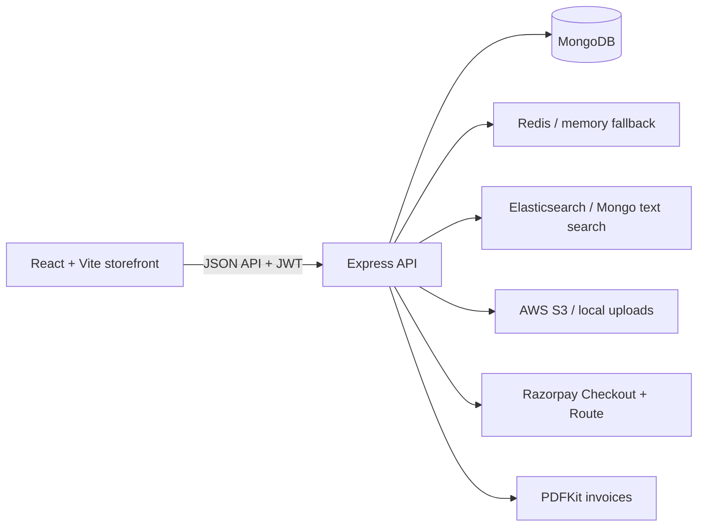

# Marketly multi-vendor marketplace

Marketly is a React storefront and Node/Express marketplace API. It supports customer accounts, seller applications and approval, catalog management, cart/checkout, order fulfillment, product reviews, coupons, invoices, and admin analytics.

## Run locally (Windows PowerShell)

1. Install Node.js 20.9 or newer and start MongoDB locally.
2. Configure `server\.env`. If there is no existing file, copy the example:

   ```powershell
   Copy-Item server\.env.example server\.env
   ```

   Set `MONGODB_URI`, two different random JWT secrets, and `CLIENT_URL`. Keep `.env` private; it is ignored by Git.
3. Install and start the API:

   ```powershell
   Set-Location server
   npm install
   npm run seed
   npm run dev
   ```

   The API listens on `http://localhost:5000`. Check `http://localhost:5000/api/health`.
4. In a second terminal, install and start the storefront:

   ```powershell
   Set-Location client
   npm install
   npm run dev
   ```

   Open the Vite URL, normally `http://localhost:5173`.
5. To create the first administrator, set `ADMIN_NAME`, `ADMIN_EMAIL`, and a unique `ADMIN_PASSWORD` of at least 12 characters in `server\.env`, then run `npm run create-admin` from `server`. Remove those one-time variables afterward.

`npm run seed` only adds missing `MKT-DEMO-*` products and their sample seller; it does not delete or overwrite other products. Skip it if you do not want sample records in the configured database. The storefront remains browsable with sample products when the API is offline, but only products saved in MongoDB can be checked out.

## Optional integrations

- **Elasticsearch:** local `http://localhost:9200` is optional. Product search falls back to MongoDB if it is unavailable.
- **Redis:** local Redis is optional. Without it, the process uses an in-memory cache. Remote Redis is deliberately disabled unless `ALLOW_REMOTE_REDIS=true` is explicitly set.
- **Images:** without AWS credentials and a bucket, optimized product images are stored under `server\uploads`. For S3, configure `AWS_REGION`, `AWS_S3_BUCKET`, `AWS_ACCESS_KEY_ID`, and `AWS_SECRET_ACCESS_KEY`.
- **Razorpay:** COD works without a payment gateway. To test online payments, configure Razorpay test keys. Razorpay Route transfers require an approved linked account ID for every seller; an administrator can link one with `PUT /api/vendors/:id/payout-account`. Orders show when split payouts still need setup or reconciliation.

## Tests and checks

```powershell
Set-Location server
npm test
npm audit

Set-Location ..\client
npm run build
```

The backend tests cover checkout tax/shipping math and commission split calculations. Payment, S3, Redis, and Elasticsearch require their corresponding external/local services for end-to-end testing.

## Architecture



## Step-by-step project walkthrough

1. **Roles and data:** `User` stores customer/vendor/admin identity; `Vendor` stores the seller profile; `Product`, `Cart`, `Order`, `Coupon`, and `Review` hold marketplace data. See [server/models/](./server/models/) for schemas and [server/routes/index.js](./server/routes/index.js) for the complete API routes.
2. **Authentication:** customers register/sign in with hashed passwords; JWT middleware protects customer, seller, and admin endpoints. Vendor access follows a seller application and administrator approval.
3. **Seller catalog:** approved vendors can add/edit/remove products and upload images. Product changes are indexed for search and invalidate cached catalog responses.
4. **Discovery:** the React shop calls the product API for live search, categories, price filters, and sorting; MongoDB text search remains available if Elasticsearch is offline.
5. **Cart and orders:** signed-in carts are stored in MongoDB and cached when Redis is available. Checkout recalculates prices and stock on the server, validates coupons, reserves stock, and creates a COD or Razorpay order.
6. **Payment and commission:** the server verifies Razorpay's HMAC signature before recording payment and computes each seller's commission and payout. Route transfers need linked seller accounts and must be tested with Razorpay test credentials.
7. **Operations:** sellers update order item status through placed/confirmed/packed/shipped/delivered; customers download PDF invoices; administrators review sellers and view sales analytics.

## Remaining work before a real launch or internship submission

- Add your own Razorpay Route test accounts and verify the full linked-account transfer/reconciliation flow.
- Configure and validate your AWS S3 bucket/IAM policy if production image storage is required.
- Deploy MongoDB, API, and frontend; set production CORS, secrets, TLS, backups, and monitoring.
- Run end-to-end tests against your chosen payment, Redis, Elasticsearch, and S3 accounts; record real results and demo screenshots/video.
- Prepare and deliver the 10-minute presentation and your personal reflection based on your project experience.

Do not use live payment credentials for a demo or commit secrets to the repository.
